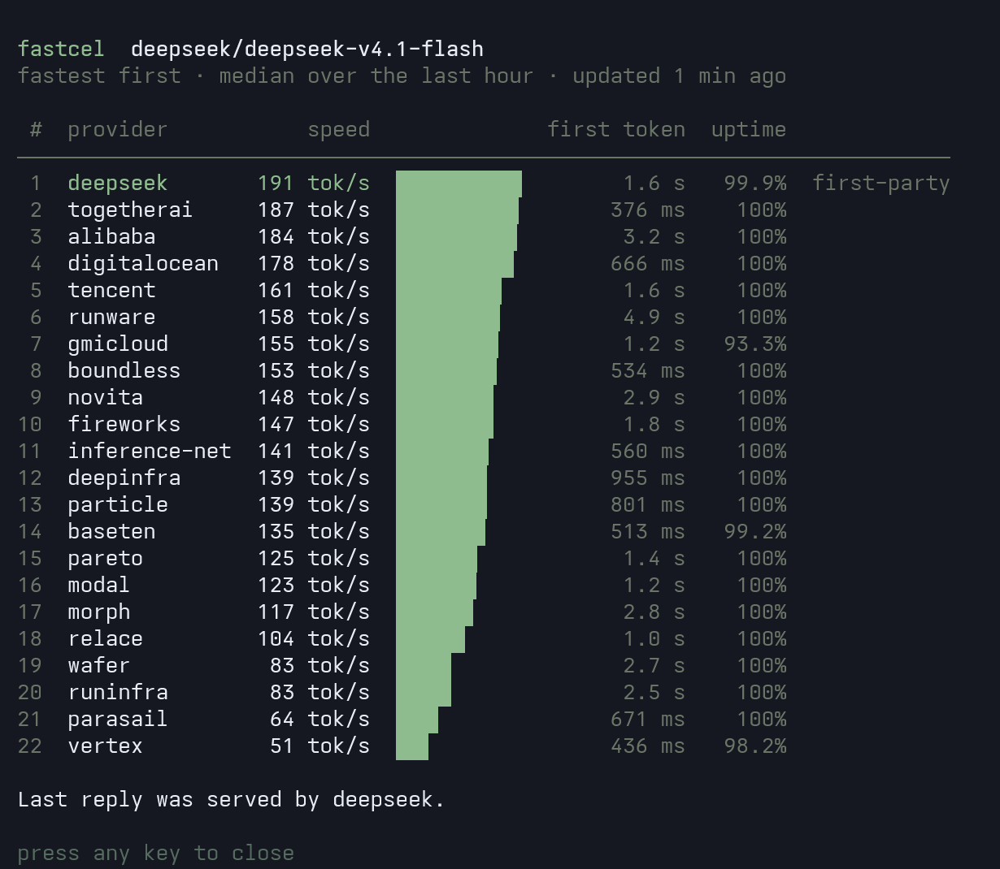

# fastcel

An [Oh My Pi](https://omp.sh) plugin that starts each Vercel AI Gateway conversation on the fastest provider for its model. It works in any terminal and adapts to [Tern](https://stencil.so/tern)'s native view.



Vercel AI Gateway serves many models through several providers, and their speeds differ a lot. `deepseek/deepseek-v4.1-flash` has 22 providers. On one afternoon the fastest, runware, produced a median of 370 tokens per second over the last hour, and the slowest, vertex, 24. Left to choose, the gateway sent two test requests to baseten (239 tok/s). With fastcel the same request went to runware.

## How it works

fastcel decides the order in which providers are tried. Vercel decides how long a conversation stays on the provider it landed on.

### fastcel ranks the providers

On every request OMP sends to `ai-gateway.vercel.sh`, fastcel attaches the model's providers, fastest first:

1. It reads the provider stats from `GET /v1/models/{model}/endpoints`. This is public data, the same figures shown on the model's page at vercel.com/ai-gateway/models, and needs no key. The stats are cached per model for 15 minutes. Once they are stale, requests keep using them while a refresh runs in the background.
2. It orders the providers by median throughput over the last hour. A provider goes to the back of the list when it is deprecated, when fewer than 90% of its requests succeeded in the last 15 minutes, when the request has tools and the provider does not support them, or when its context window is smaller than the conversation.
3. It sends the list as `providerOptions.gateway.order`. If the first provider fails, the gateway falls back through the rest in speed order.

fastcel keeps no memory between requests: each one carries the ranking as it stands at that moment. If the stats cannot be loaded, the request goes out unchanged and the gateway chooses as usual.

### Vercel keeps a conversation on one provider

The gateway does not simply take the first provider on the list. Its [session affinity](https://vercel.com/docs/ai-gateway/models-and-providers/session-affinity), on by default, remembers which provider answered a conversation's previous message and tries that provider first, so its prompt cache stays warm. In a session this plays out as follows:

1. **First message.** No provider is remembered yet, so the message goes to the top of fastcel's list, runware in the example above.
2. **Following messages.** They stay on runware, even if fastcel's ranking changes in the meantime.
3. **After a pause or a failure.** Vercel forgets the provider once the conversation has been idle longer than that provider's cache lifetime: about 5 minutes for most providers, 10 for OpenAI and Azure, and 1 hour for DeepSeek's own API. It also forgets it when the provider fails a request. The next message goes to whichever provider is fastest at that point, and the conversation stays there.

A new OMP session or a subagent counts as a new conversation, so it starts on whichever provider is fastest when it begins.

### Details

- **Your routing wins.** A `model@provider` selector (`vercel-ai-gateway/deepseek/deepseek-v4.1-flash@togetherai`) or `compat.vercelGatewayRouting` in `models.yml` is sent as you wrote it, and fastcel does not rank that model. OMP 18.14 drops those settings on the Anthropic Messages route it uses for every Vercel model, so fastcel sends them itself.
- **Some providers are skipped for your account.** Vercel marks some providers `plan_not_eligible` for some models. The gateway then moves on to the next provider in the list without trying the skipped one.
- **Why not `sort: "tps"`.** The gateway can sort providers by throughput itself, but in testing most providers had no value in that sort. For `openai/gpt-oss-120b` only baseten (248 tok/s) had one, so groq (480 tok/s) came after slower providers. fastcel ranks with the endpoint stats instead.

## Install

```sh
omp plugin install github:DavidCarliez/fastcel
```

From a local checkout, link it instead: `omp plugin link /path/to/fastcel`.

You need a Vercel AI Gateway key configured for OMP's `vercel-ai-gateway` provider, either in `AI_GATEWAY_API_KEY` or through `/login`. fastcel is tested with OMP 18.14.0.

## Use

Pick any Vercel AI Gateway model, with `/model` or `--model vercel-ai-gateway/deepseek/deepseek-v4.1-flash`. fastcel shows the top of its current ranking, the provider and its speed:

```
subconscious · 445 tok/s
```

Where it shows depends on the terminal:

- **A plain terminal**: under the status line.
- **Tern**: on a row of its own under the composer. Tern hides extension statuses once the status bar fills up with usage figures, so fastcel draws its own row there instead.
- **With [Cover](https://github.com/DavidCarliez/cover) installed**: next to Cover's lock, on one line, in either terminal: `🔓  subconscious · 445 tok/s`.

When the model's maker serves it from its own API, that provider has the maker's name, so the line marks it first-party. `deepseek (first-party) · 191 tok/s` means DeepSeek's own API, not the DeepSeek model.

A conversation that started earlier can still be on another provider, as described above. `/fastcel` shows where the last reply actually went.

| Command            | Effect                                                                               |
| ------------------ | ------------------------------------------------------------------------------------ |
| `/fastcel`         | Ranks the current model's providers and shows which provider served the last reply. |
| `/fastcel <model>` | Ranks the providers of any gateway model, e.g. `/fastcel zai/glm-5.1`.              |
| `/fastcel refresh` | Drops cached stats and fetches them again.                                           |

`/fastcel` opens a table of the model's providers, fastest first, with each provider's speed, time to first token and uptime over the last 15 minutes. A note marks the first-party provider and says why a provider was moved down the list. Under the table, a line says which provider served the last reply. Any key closes it.

Tern and a plain terminal draw the same table, as in the screenshot at the top. Clients without the interactive TUI, such as RPC hosts, get it as plain text.

The served-by line comes from Vercel's generation lookup, which uses your gateway key. Vercel publishes that record up to a minute after the reply; until then `/fastcel` says so.

To turn fastcel off, run `omp plugin disable fastcel`.

### Sharing a line with another plugin

A plugin that draws a line of its own can carry fastcel's text, as Cover does next to its lock. The plugins talk over OMP's shared event bus, `pi.events`:

| Channel                | Payload                                | Sent by                                                           |
| ---------------------- | -------------------------------------- | ----------------------------------------------------------------- |
| `indicator-line:host`  | `{ id: string, active: boolean }`      | The drawing plugin, when it loads, when asked, and when it stops. |
| `indicator-line:query` | none                                   | fastcel, when it loads, to find a plugin that loaded first.       |
| `indicator-line:item`  | `{ key: "fastcel", text: string \| undefined }` | fastcel, whenever its text changes; `undefined` removes it.       |

While at least one plugin is active on `indicator-line:host`, fastcel posts its text there instead of drawing it. Use a unique `id` per loaded copy: subagent sessions share the bus and load their own copy of each plugin.

## Develop

```sh
bun install
bun test
bun run typecheck
omp -e ./src/index.ts --model vercel-ai-gateway/deepseek/deepseek-v4.1-flash
```

`src/ranking.ts` orders providers, `src/stats.ts` fetches and caches the endpoint stats, `src/panel.ts` draws `/fastcel`, and `src/index.ts` wires them into OMP.

## License

[MIT](LICENSE)
